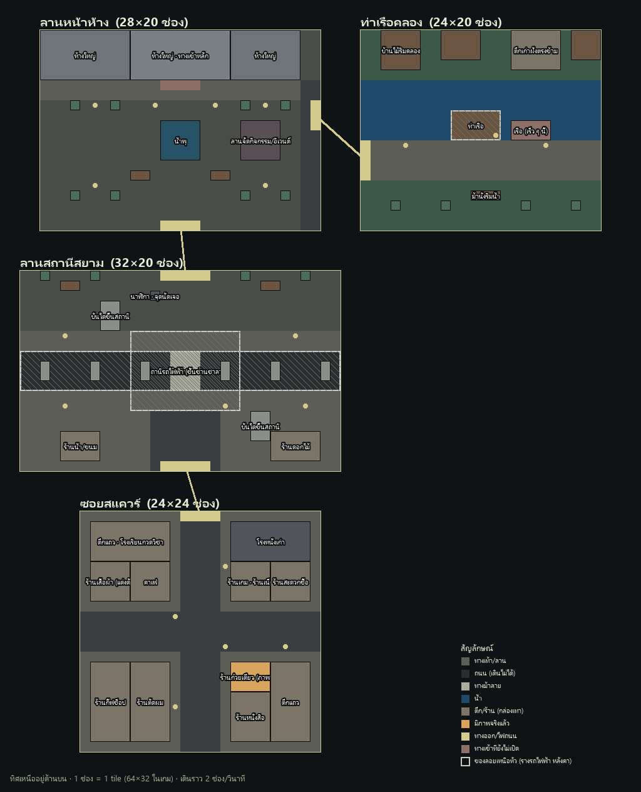

# Chill Town

เกมออนไลน์บนเว็บไว้เดินเล่น แต่งตัว และคุยกัน แนว Zheza ฉากเป็นกรุงเทพแบบดัดแปลง ใจกลางคือย่านสยาม · Phaser 4 + TypeScript · isometric pixel art

- โน้ตโปรเจกต์ (เริ่มอ่านที่นี่): [`PROJECT_NOTES.md`](PROJECT_NOTES.md)
- Game design: [`design/GDD.md`](design/GDD.md)
- ผังใจกลางสยาม: [`design/siam-layout.md`](design/siam-layout.md) · 

## โครงสร้าง

```
shared/   ใช้ร่วมกันทั้งสองฝั่ง: ข้อมูลห้อง (rooms.ts) · collision · พิกัด iso · นาฬิกาเกม · ผังรถไฟฟ้า
client/   หน้าบ้าน (Phaser 4 + Vite)
  src/model/       สถานะและกติกา ไม่มี Phaser (โลก/เวลา, ห้อง, ผู้เล่น)
  src/view/        วาดอย่างเดียว (ห้อง, ผู้เล่น, แสงตามเวลา, HUD, art/)
  src/controller/  รับ input + วนลูปเกม + เปลี่ยนห้อง (GameController, InputController, actions)
server/   หลังบ้าน (Node 24 รัน TypeScript ตรง ไม่ต้อง build)
  src/models/ · src/views/ · src/controllers/ · routes.ts
```
กติกา: view ไม่แก้ model เอง (เรียกผ่าน controller) · model ไม่ import Phaser · โค้ดใน `shared/` ห้ามใช้ syntax เฉพาะ TS ที่ลบทิ้งไม่ได้ (enum, parameter properties) เพราะ Node รันตรง

## รัน

```
cd client && npm install && npm run dev-nolog     # เกม: http://localhost:8080
cd server && npm install && npm start             # API: http://localhost:2567/api/time
```
ทดสอบ: `?look=2.1.2.beanie.round_glasses` ลองชุด (`shared/avatar.ts`) · `?room=soi` กระโดดไปห้อง · `?zoom=0.75` · `?time=18:30` เริ่มที่เวลานั้น · `?rain=0` ไม่มีฝน
API: `/api/health` · `/api/time` · `/api/rooms` · `/api/rooms/plaza/walkable?i=16&j=3`

## Map editor

เปิด server ก่อน (`cd server && npm run dev`) แล้วเข้า http://localhost:8080/?edit=1&room=plaza
- เครื่องมือ: 1 เลือก/ย้าย · 2 วางของ · 3 ระบายพื้น · 4 ไฟถนน · 5 ทางออก · 6 จุดเกิด · 7 ทางคนเดิน
- Ctrl+Z / Ctrl+Y ย้อน/ทำซ้ำ · Ctrl+S บันทึก · Del ลบ · R หมุน · WASD หรือลากเมาส์ขวา เลื่อนกล้อง · ล้อเมาส์ ซูม
- บันทึกลง `shared/rooms/<ห้อง>.json` (ผ่าน server ซึ่งตรวจห้องก่อน: จุดเกิด ทางออก หน้าร้าน ของทับกัน) แล้วเกมโหลดห้องใหม่เอง
- บันทึกได้เฉพาะจากเครื่องนี้ และปิดเองเมื่อ `NODE_ENV=production`
- ของที่วางได้อยู่ใน `client/src/model/editorCatalog.ts`

## Avatar editor

เปิด server ก่อน (`cd server && npm run dev`) แล้วเข้า http://localhost:8080/?avatar=1
- เห็นตัวละคร 4 ทิศ (SE SW NW NE) ท่ายืน กับตัวที่เล่นท่า · กรอบฟ้า = ตำแหน่งหัวจาก `player_rig.json`
- ติ๊กเพื่อใส่/ถอดชิ้น · คลิกชื่อชิ้นเพื่อเลือก แล้วลากชิ้นบนตัวละคร หรือกดลูกศร (Shift = 4 px) · 1–4 เลือกทิศ
- "คัดลอกไปทิศกระจก" = ใช้ค่าของทิศนี้กับทิศคู่ (SE↔SW, NW↔NE) โดยกลับ x
- Ctrl+Z / Ctrl+Y ย้อน/ทำซ้ำ · Ctrl+S บันทึกลง `shared/parts.json` (server ตรวจก่อน: ชิ้นต้องมีภาพใน `client/public/assets/head/`)
- ชิ้นที่มี `sway` (หางม้า ผ้าพันคอ): แผง "ฟิสิกส์" ปรับความแข็ง/ความหน่วง/แรงขับของสปริง · กด ▶ ให้ตัวอย่างวิ่ง แล้ว ❚❚ ดูหางแกว่งกลับ
- เพิ่มชิ้นใหม่: วางภาพ `head/<id>.png` แล้วเพิ่มบรรทัดใน `shared/parts.json` เอง (editor ยังสร้างชิ้นใหม่ไม่ได้)

## Git

ทำงานบน feature branch (`feature/...`) แล้วเปิด Pull Request เข้า `main` ไม่ commit ตรงเข้า `main`

## เครื่องมือ

- `tools/pixelfix.py`: แปลงภาพ AI เป็น pixel art จริง (`--help`)
- `tools/render_map.py`: วาดผังมุมบนจาก `shared/rooms.ts`
- `tools/char_rig.py`: วัดตำแหน่งหัวทุกเฟรมและสีผิวของ `player.png` → `client/src/model/player_rig.json` (รันใหม่ทุกครั้งที่เปลี่ยนตัวละคร)
- `tools/head_parts.py`: template สำหรับวาดชิ้นหัว · ดูชิ้นหัวบนตัวละครทุกเฟรม (`preview`)
- `tools/blank_face.py`: ลบหน้าที่ Autosprite วาดมาออกจากชีตตัวละคร ให้เหลือหัวเปล่าไว้ซ้อนชิ้นหน้า
- `tools/hair_part.py`: วาดทรงผมทดสอบจากรูปหัวจริง (`pony` ตัวผม + `pony_tail` หางม้า 5 ท่าพลิ้ว) เป็นสีเทา เกมย้อมเป็นสีผม
- `tools/face_part.py`: ดึงหน้าที่ Autosprite วาดมาเป็นชิ้นหน้า (`head/<id>.png`) พร้อมเฟรมครึ่งหลับ/หลับตา ใส่ `"blink": true` ใน `shared/parts.json` แล้วเกมกะพริบให้เอง
