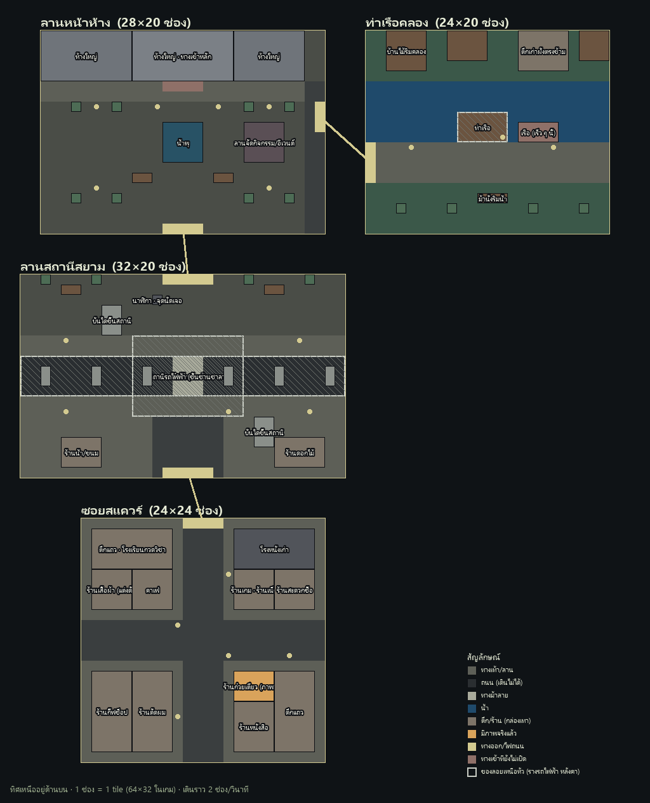

# Chill Town

เกมออนไลน์บนเว็บไว้เดินเล่น แต่งตัว และคุยกัน แนว Zheza ฉากเป็นกรุงเทพแบบดัดแปลง ใจกลางคือย่านสยาม · Phaser 4 + TypeScript · isometric pixel art

- โน้ตโปรเจกต์ (เริ่มอ่านที่นี่): [`PROJECT_NOTES.md`](PROJECT_NOTES.md)
- Game design: [`design/GDD.md`](design/GDD.md)
- ผังใจกลางสยาม: [`design/siam-layout.md`](design/siam-layout.md) · 

## โครงสร้าง

```
shared/   ใช้ร่วมกันทั้งสองฝั่ง: ข้อมูลห้อง (rooms.ts) · collision · พิกัด iso · นาฬิกาเกม · ผังรถไฟฟ้า
client/   หน้าบ้าน (Phaser 4 + Vite)
  src/model/       สถานะและกติกา ไม่มี Phaser (โลก/เวลา, ห้อง, ผู้เล่น)
  src/view/        วาดอย่างเดียว (ห้อง, ผู้เล่น, แสงตามเวลา, HUD, art/)
  src/controller/  รับ input + วนลูปเกม + เปลี่ยนห้อง (GameController, InputController, actions)
server/   หลังบ้าน (Node 24 รัน TypeScript ตรง ไม่ต้อง build)
  src/models/ · src/views/ · src/controllers/ · routes.ts
```
กติกา: view ไม่แก้ model เอง (เรียกผ่าน controller) · model ไม่ import Phaser · โค้ดใน `shared/` ห้ามใช้ syntax เฉพาะ TS ที่ลบทิ้งไม่ได้ (enum, parameter properties) เพราะ Node รันตรง

## รัน

```
cd client && npm install && npm run dev-nolog     # เกม: http://localhost:8080
cd server && npm install && npm start             # API: http://localhost:2567/api/time
```
ทดสอบ: `?room=soi` กระโดดไปห้อง · `?zoom=0.75` · `?time=18:30` เริ่มที่เวลานั้น · `?rain=0` ไม่มีฝน
API: `/api/health` · `/api/time` · `/api/rooms` · `/api/rooms/plaza/walkable?i=16&j=3`

## Git

ทำงานบน feature branch (`feature/...`) แล้วเปิด Pull Request เข้า `main` ไม่ commit ตรงเข้า `main`

## เครื่องมือ

- `tools/pixelfix.py`: แปลงภาพ AI เป็น pixel art จริง (`--help`)
- `tools/render_map.py`: วาดผังมุมบนจาก `shared/rooms.ts`
